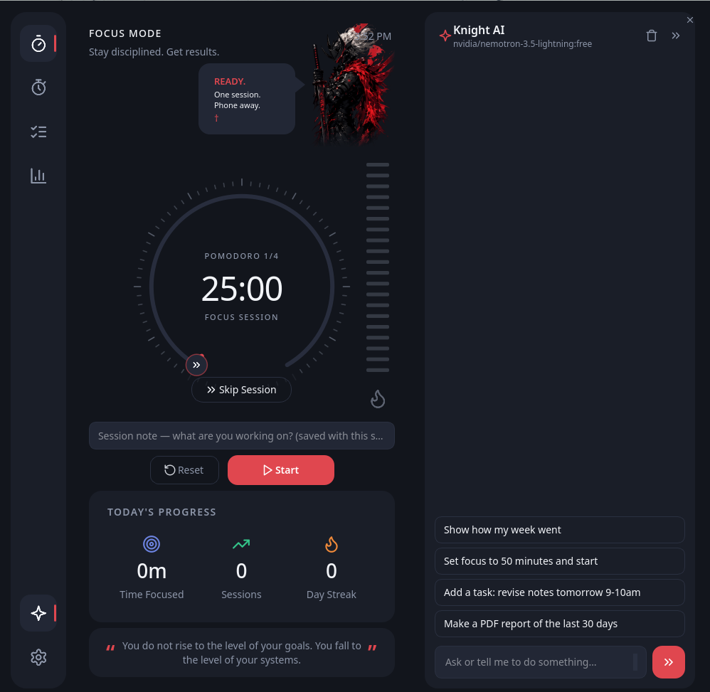
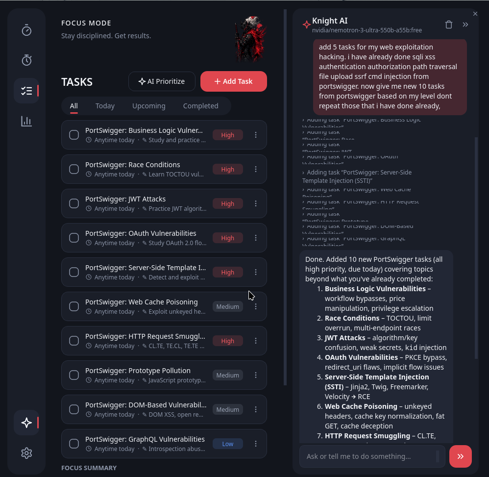
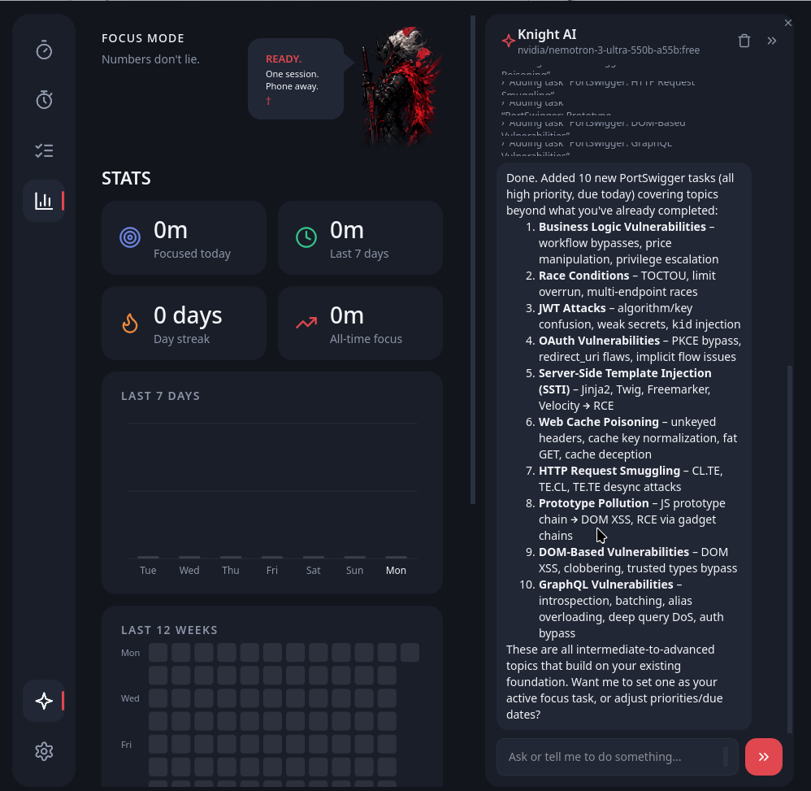

# Focus Mode

A dark, distraction-fighting focus timer for Linux, with a knight guardian who tells you to put the phone down.
Built with PySide6 (Qt). Data in SQLite, settings in TOML.

<p align="center">
   &nbsp;|&nbsp;  &nbsp;|&nbsp; 
</p>

<p align="center">
  <sub><b>Timer</b> &nbsp;·&nbsp; <b>Tasks</b> &nbsp;·&nbsp; <b>Stats</b></sub>
</p>

## What is Focus Mode?

Focus Mode is more than a Pomodoro timer — it's a personal focus companion that actually *remembers* your work. Every task you complete, every session note you write, and every day of stats you log is quietly indexed into a local **RAG (Retrieval-Augmented Generation) memory**. The built-in AI assistant can then search that memory to:

- **See how much you've actually learned and done** — it reads your history, session notes and stats to summarise your progress over any time range.
- **Suggest what to focus on next** — based on patterns in your past sessions, unfinished tasks and topic history, it recommends the next task, a priority order, or a study direction.
- **Answer questions about your own data** — "how many deep-work hours did I log this month?", "what did I note about the Linux kernel task?", "which topic keeps getting postponed?"
- **Generate PDF reports** of your focus history for a chosen period.
- **Control the app by voice of text** — start the timer, switch tabs, edit tasks, change settings, all through chat.

All of this runs **locally**. The RAG memory lives in a ChromaDB store inside your data folder; nothing leaves your machine unless you explicitly configure an AI provider and press an AI button.

## Install

Python 3.11+ (tested on 3.13; 3.14 works with a PySide6 wheel that supports it).

```bash
cd focus-mode-app
python -m venv .venv && source .venv/bin/activate
pip install -e .        # editable: code changes apply immediately
# or:  pip install .    # normal install
focus-mode              # launch
focus-mode --install-desktop   # optional: add to your applications menu
```

## Pages

Timer (Pomodoro) · Stopwatch (laps, saved to stats) · Tasks · Stats · Settings.
Shortcuts: **Ctrl+1 … Ctrl+5**.

## Where things are stored

| What | Path |
| --- | --- |
| Settings | `~/.focus-mode/config/config.toml` (private, mode 600, may hold your AI key) |
| Data | `~/.focus-mode/data/focus.db` |

Set `FOCUS_MODE_HOME=/some/dir` to relocate both.

## AI (optional)

Settings → AI: any OpenAI-compatible base URL, API key and model (OpenAI, OpenRouter, Groq, LM Studio,
Ollama at `http://localhost:11434/v1`). Used for task priorities, knight messages and stats insights.
Nothing is sent unless you configure it and press an AI button or enable AI messages.

## AI assistant (chat sidebar)

Open it with the sparkle button in the sidebar or **Ctrl+J**. In **Settings → AI** enter your
OpenRouter details (base URL `https://openrouter.ai/api/v1`, your key, and a model).
**The model must support tool calling** (most current OpenRouter chat models do; if not you get a clear message).

The assistant can:

- Start/pause/reset the timer and stopwatch
- Change settings (timer lengths, accent, style, sound, animations, knight messages, memory mode, your name)
- Switch tabs
- Add/edit/complete/delete tasks (deleting asks you to confirm)
- Focus on a task
- Read and edit session notes
- Read your stats
- Search your history
- Write a PDF report (saved to `~/Documents/FocusMode` by default)

It cannot read or change your API key, URL or model.

### Memory (ChromaDB, kept light)

- Local only, stored in the data folder under `chroma/`. Nothing is uploaded except the chat itself.
- ChromaDB is imported **lazily** (only when the assistant searches your history) and unloaded after 90 s idle.
- Incremental indexing: only new or changed tasks, session notes and day summaries are re-embedded.
- **Light** mode (default): built-in hashing embedding, no download, tiny RAM.
- **Neural** mode: Chroma's MiniLM model (~90 MB one-time download, more RAM).
- Switch in Settings → Memory & agent.
- If ChromaDB is missing or fails, search falls back to plain keyword matching.

### Notes

Tasks have a notes field (Add/Edit task). The Timer and Stopwatch pages have a session note box that is
saved with the next logged session; recent sessions and their notes are listed on the Stats page.

### PDF report

Ask the assistant ("make a PDF report of the last 30 days"). The built-in font cannot draw Bangla or other
non-Latin scripts; those characters appear as `?` in the PDF.

## Layout (engine vs interface)

```
src/focus_mode/
  config.py db.py engine.py ai.py messages.py alerts.py   # logic, no widgets
  services.py                                              # glue shared by pages
  ui/  theme.py widgets.py ring.py avatar.py main_window.py pages/*   # PySide6 interface
tests/   pytest -q   (24 tests; run headless)
```

## Notes

- Sound plays through `pw-play` / `paplay` / `aplay` / `ffplay` if present; notifications use `notify-send` or the tray.
- Always-on-top mini timer may be ignored by some Wayland compositors.
- The knight is `assets/knight.png`; the icon is `assets/icon.png`. Replace them to change the look.

## Uninstall

Everything the app stores lives in one folder, so a full clean-up is:

```bash
pip uninstall focus-mode          # or: pipx uninstall focus-mode
rm -rf ~/.focus-mode              # database, settings (incl. API key), AI memory, cache
rm -f ~/.local/share/applications/focus-mode.desktop   # only if you added the launcher entry
rm -rf ~/Documents/FocusMode      # only if you want to delete generated PDF reports
```